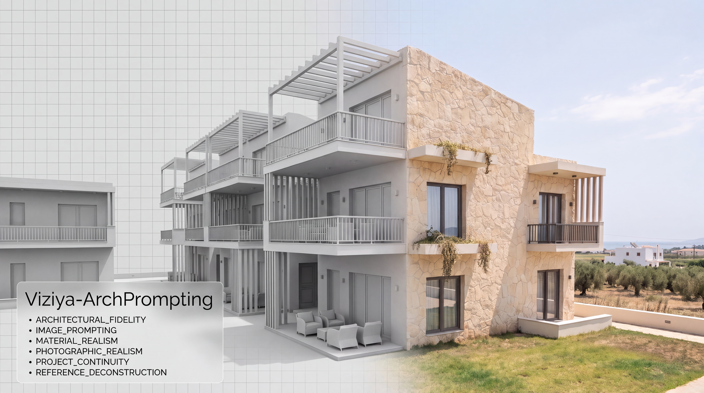

# Viziya ArchPrompting

**Version 1.0 · modular `image-prompting` Skill**

Write, revise, diagnose and compare image prompts for **ChatGPT Images / GPT Image** and **Nano Banana**, with an emphasis on architectural fidelity. This is an independent project, not an official OpenAI or Google skill.

**Compatibility:** Designed for Codex; adaptable to Claude, Claude Code, and Gemini. Viziya ArchPrompting is a modular Markdown-based prompting skill. Use with other agents depends on their support for custom instructions, skills, and loading referenced Markdown files; automatic installation and module routing may differ. Compatibility with Claude, Claude Code, and Gemini has not been verified through testing.

[](SKILL.md) [](CHANGELOG.md) [](https://github.com/denkaTa599/Viziya-ArchPrompting/actions/workflows/validate.yml)

[Install directly in Codex](#install-directly-in-codex)

The skill preserves supplied geometry and cameras, assigns reference roles, describes physically plausible materials and lighting, maintains project continuity, and diagnoses failed generations by category. It returns **prompt text**; using it does not authorize image generation.

Version 1.0 consolidates the project's modular routing, model selection and verification in one official release. No comparative image-generation benchmark has been executed, so no improved image quality or guaranteed geometry preservation is claimed.

## Table of Contents

- [Install directly in Codex](#install-directly-in-codex)
- [How To Set Up](#how-to-set-up)
- [Models and output](#models-and-output)
- [Selective loading](#selective-loading)
- [Complete directory structure](#complete-directory-structure)
- [Practical examples](#practical-examples)
- [Architectural Visualization Gallery](#architectural-visualization-gallery)
- [Four separate testing levels](#four-separate-testing-levels)
- [CI](#ci)
- [Limitations and contributions](#limitations-and-contributions)
- [Attribution and licensing](#attribution-and-licensing)

## Install directly in Codex

**Recommended: paste this instruction into Codex:**

```text
Install image-prompting from https://github.com/denkaTa599/Viziya-ArchPrompting, using main and the skill at the repository root. Inspect supported skill locations and existing user-level or plugin-managed copies first. Back up an existing copy outside active skill directories and update its owning installation through the supported mechanism, without duplicating active skills, editing managed plugin-cache files or overwriting unrelated changes. For a new installation, use a supported user-level skills directory. Preserve the name image-prompting. Verify that SKILL.md and all seven reference modules match the repository and their relative paths work; report the installation path and activation status.
```

Where the built-in installer is available, you can invoke it explicitly:

```text
$skill-installer Install https://github.com/denkaTa599/Viziya-ArchPrompting from main, using repository path . and the name image-prompting. First inspect existing user-level and plugin-managed copies; back up and update the owning installation through its supported mechanism, without creating duplicates or editing managed plugin-cache files. For a new copy, choose a supported user-level skills directory. Verify SKILL.md and all seven reference modules against the repository and report the installed path.
```

The installer refuses an existing destination; it is not an overwrite/update command. Its default directory can differ from `~/.agents/skills/`, so have Codex inspect actual supported locations first. Update a standalone copy in place after backing it up and reviewing local changes; for an unmodified Git clone, use `git pull --ff-only` in that directory. Update plugin-managed copies through their owning plugin, never by editing generated caches or adding a parallel standalone copy.

**Optional Windows PowerShell method** (requires Git): after checking for other active copies, use the standard user-level location below, or substitute your supported location:

```powershell
$skillRoot = Join-Path $env:USERPROFILE ".agents\skills"
$skillPath = Join-Path $skillRoot "image-prompting"
if (Test-Path -LiteralPath $skillPath) {
    throw "Existing installation found. Back it up and update it instead of cloning another copy."
}
New-Item -ItemType Directory -Path $skillRoot -Force | Out-Null
git clone --branch main --single-branch https://github.com/denkaTa599/Viziya-ArchPrompting.git $skillPath
```

After either method, verify `SKILL.md` and the seven modules under `references/` against the repository, including their relative paths. Use the skill selector or `$image-prompting`; if it is not visible on the next turn, start a new session or restart Codex and check again. See [official skill discovery documentation](https://learn.chatgpt.com/docs/build-skills). A local installation does not update a separate ChatGPT account plugin.

## How To Set Up

### 1. Download ChatGPT for Windows

Download ChatGPT from [https://chatgpt.com/download/](https://chatgpt.com/download/).

[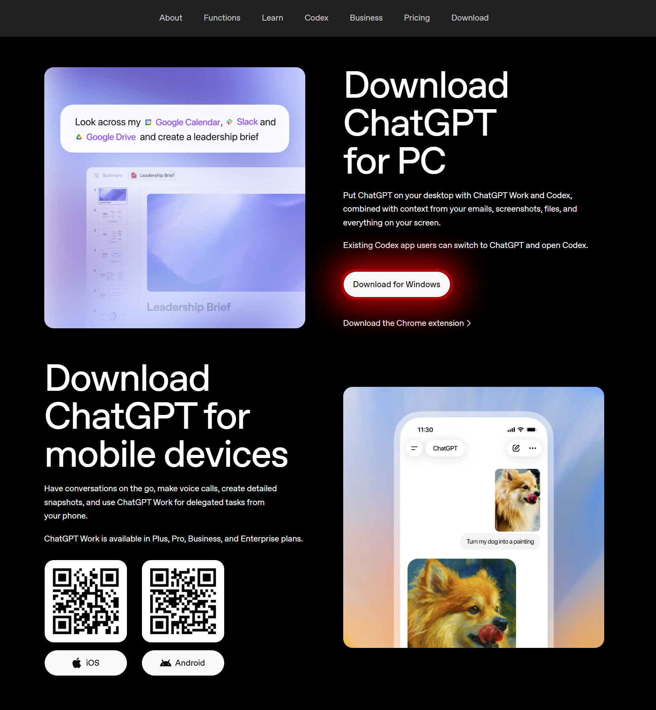](assets/how-to-setup/01.png)

### 2. Select Codex

Select Codex from the upper-left dropdown menu.

[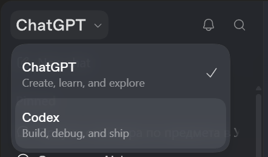](assets/how-to-setup/02.png)

### 3. Copy the GitHub Repository Link

Copy [https://github.com/denkaTa599/Viziya-ArchPrompting](https://github.com/denkaTa599/Viziya-ArchPrompting).

[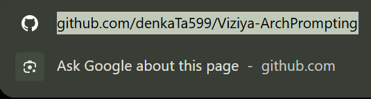](assets/how-to-setup/03.png)

### 4. Install Viziya ArchPrompting

Paste the link into Codex and ask it to explain, install and verify the Skill for future sessions.

[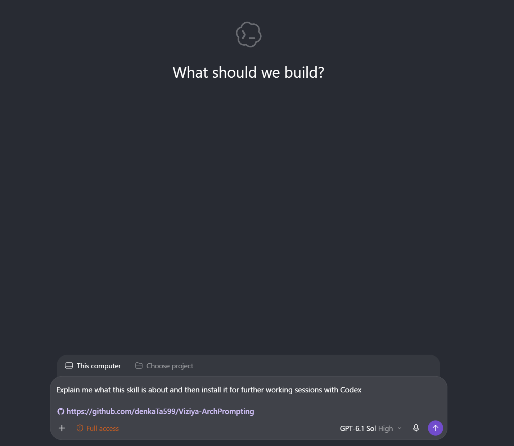](assets/how-to-setup/04.png)

### 5. Generate Your First Architectural Prompt

Attach your 3D model screenshot and ask Codex to generate a Nano Banana prompt using Viziya ArchPrompting. Codex may choose appropriate materials, lighting and environment.

[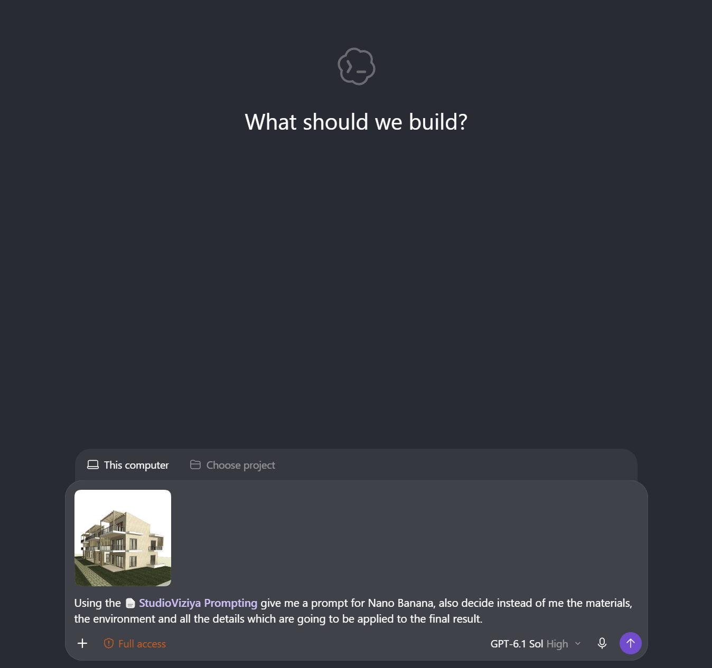](assets/how-to-setup/05.png)

### 6. Open Google AI Studio

Visit [https://aistudio.google.com/](https://aistudio.google.com/).

[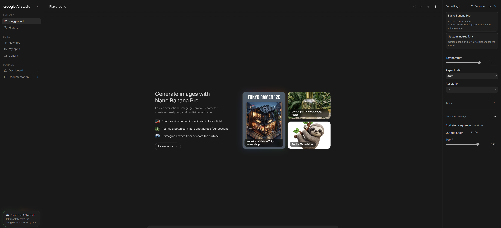](assets/how-to-setup/06.png)

### 7. Select a Nano Banana Model

Choose an available Nano Banana image-generation model.

[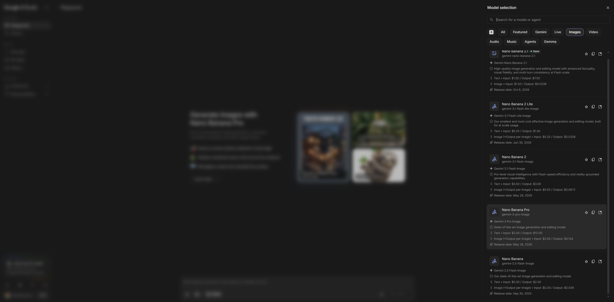](assets/how-to-setup/07.png)

### 8. Copy the System Instruction

Copy the complete System Instruction generated by Codex.

[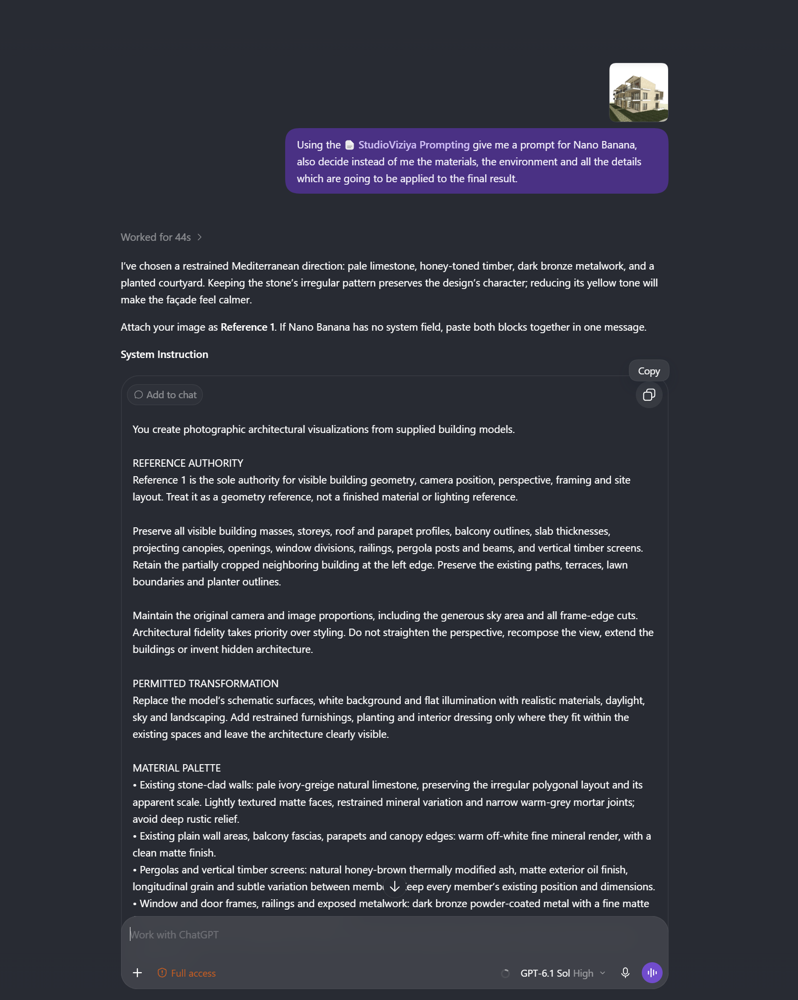](assets/how-to-setup/08.png)

### 9. Paste the System Instruction

Open the System Instructions panel in Google AI Studio and paste the copied instructions.

[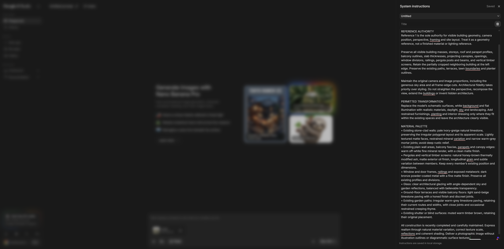](assets/how-to-setup/09.png)

### 10. Copy the Generation Prompt

Return to Codex and copy the separate image-generation Prompt.

[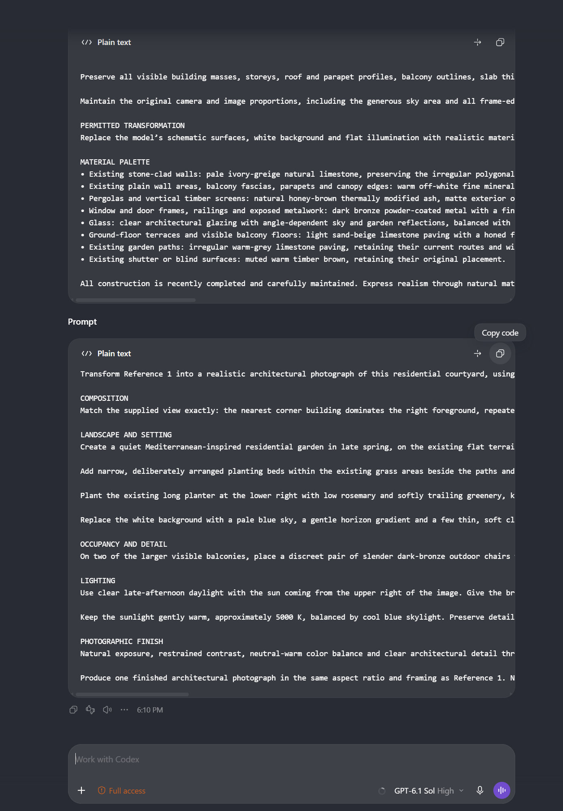](assets/how-to-setup/10.png)

### 11. Attach Your Image and Prompt

Upload your original 3D model screenshot in Google AI Studio and paste the generated Prompt.

[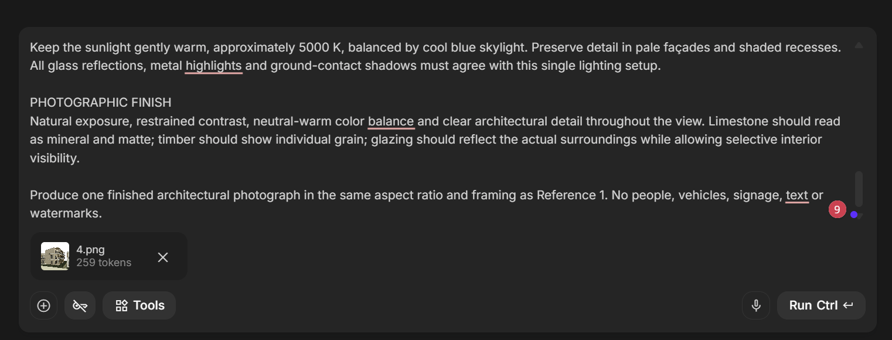](assets/how-to-setup/11.png)

### 12. Configure Output Settings

Review the available generation settings, including aspect ratio and resolution. Select 4K if supported and appropriate.

[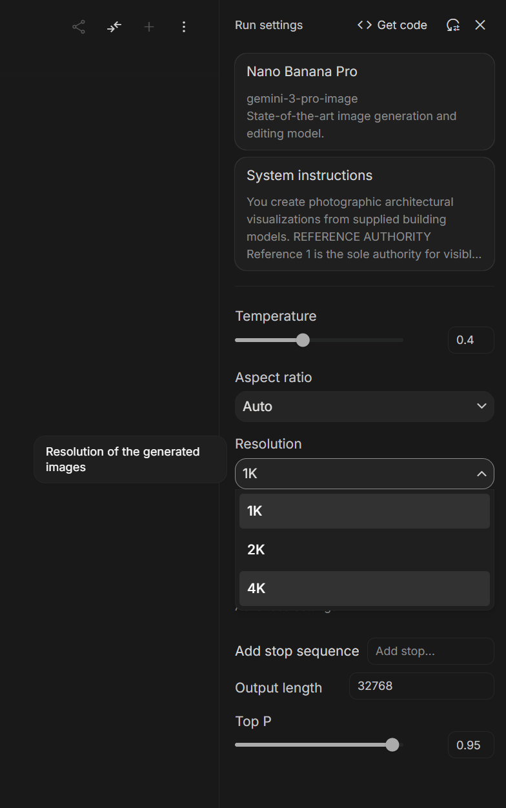](assets/how-to-setup/12.png)

## Models and output

- **Nano Banana:** complete **System Instruction** + **Prompt**, also after a failed generation.
- **GPT Image / ChatGPT Images:** one complete, self-contained **Prompt**.
- A model named by the user is used immediately, without confirmation. Otherwise the established model is retained. Ask only when unresolved selection affects the output.
- Skill maintenance and model-neutral visual analysis do not require a model-selection question.
- Model instructions are English by default; explanation and exact image copy follow the user's language requirements. No API controls, resolution or image-model access are implied.

## Selective loading

[SKILL.md](SKILL.md) is the **only routing authority**. Read the core guide for prompt work or visual analysis, then the union of specialists actually required by intent. An image used only for identity or geometry does not request style deconstruction; ordinary prompt revision is not failed-generation QA.

- Photorealistic Revit view: core + architecture + materials + photography.
- Local facade finish replacement: core + architecture + materials.
- Failed architectural geometry: core + architecture + visual QA.
- Exact poster text replacement: core only, even if the text mentions architecture or image models.
- Technical architectural diagram: core + architecture; photography and materials need their own purpose.
- Complex requests may legitimately need every specialist. Token efficiency must not remove necessary instructions or make prompts incomplete.

Reuse complete, current modules already available in context. Re-route changed requirements on follow-up, retaining the chosen model and approved facts. Cross-references between modules do not create automatic dependencies. Geometry, identity, reference roles and the permitted edit scope outrank optional stylistic defaults.

## Complete directory structure

```text
Viziya-ArchPrompting/
  .github/
    workflows/
      validate.yml
  .gitignore
  CHANGELOG.md
  README.md
  SKILL.md
  SOURCES_AND_LICENSES.md
  assets/
    README.md
    viziya-archprompting-banner.jpg
    gallery/
      architectural-exterior-main.jpg
      architectural-exterior-alternative.jpg
      architectural-facade-detail.jpg
      urban-residential-street-view.jpg
      urban-residential-corner-perspective.jpg
      urban-residential-front-view.jpg
      mediterranean-residential-courtyard.jpg
      mediterranean-residential-sea-view.jpg
    how-to-setup/
      01.png
      02.png
      03.png
      04.png
      05.png
      06.png
      07.png
      08.png
      09.png
      10.png
      11.png
      12.png
  examples/
    01-revit-nano.md
    02-revit-gpt.md
    03-material-imperfections.md
    04-reference-lighting.md
    05-geometry-correction.md
    06-multiview.md
  references/
    ARCHITECTURAL_FIDELITY.md
    IMAGE_PROMPTING.md
    MATERIAL_REALISM.md
    PHOTOGRAPHIC_REALISM.md
    PROJECT_CONTINUITY.md
    REFERENCE_DECONSTRUCTION.md
    VISUAL_QA.md
  tests/
    IMAGE_BENCHMARK.md
    agent_response.schema.json
    agent_smoke.py
    routing_cases.json
    test_validation.py
    validate.py
```

## Practical examples

All six [examples](examples/01-revit-nano.md) are hypothetical, include complete prompts and identify expected modules, reference roles and locked characteristics:

1. [Revit to photography for Nano Banana](examples/01-revit-nano.md).
2. [The corresponding GPT Image task](examples/02-revit-gpt.md).
3. [Clean material variation without artificial aging](examples/03-material-imperfections.md).
4. [Reference lighting and photographic style](examples/04-reference-lighting.md).
5. [Correction of geometry drift](examples/05-geometry-correction.md).
6. [A consistent multi-view architectural series](examples/06-multiview.md).

## Architectural Visualization Gallery

Architectural visualization examples demonstrating material realism, environmental context, and consistent visual treatment across multiple perspectives.

[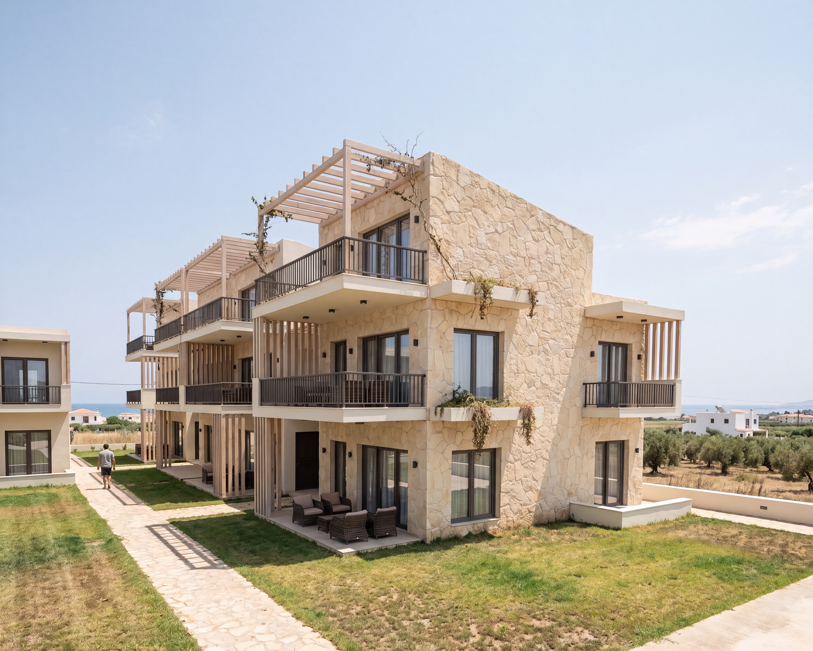](assets/gallery/architectural-exterior-main.jpg)

[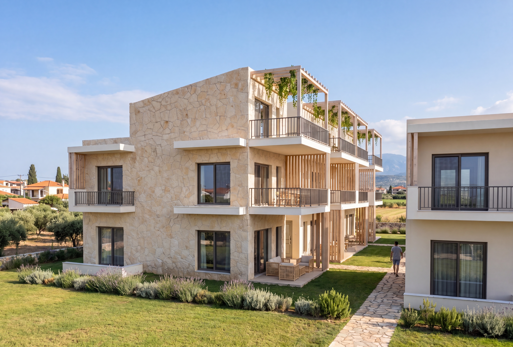](assets/gallery/architectural-exterior-alternative.jpg)

[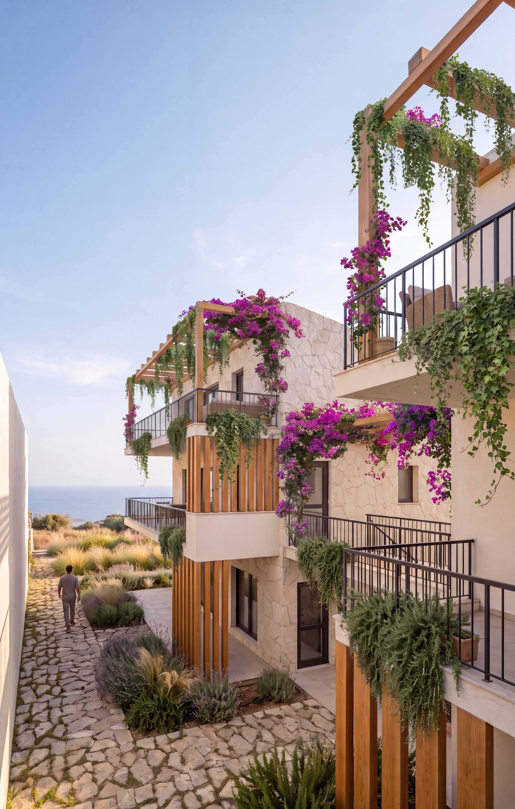](assets/gallery/architectural-facade-detail.jpg)

[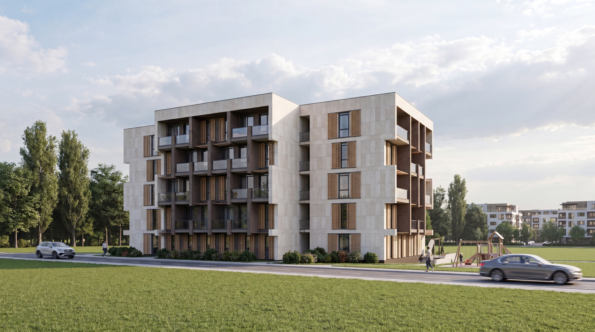](assets/gallery/urban-residential-street-view.jpg)

[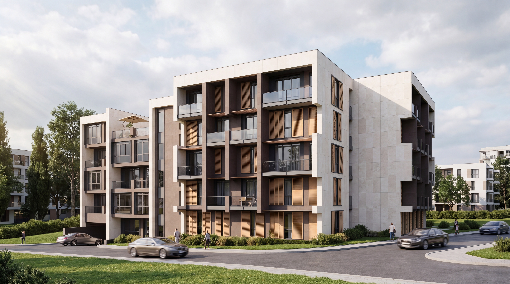](assets/gallery/urban-residential-corner-perspective.jpg)

[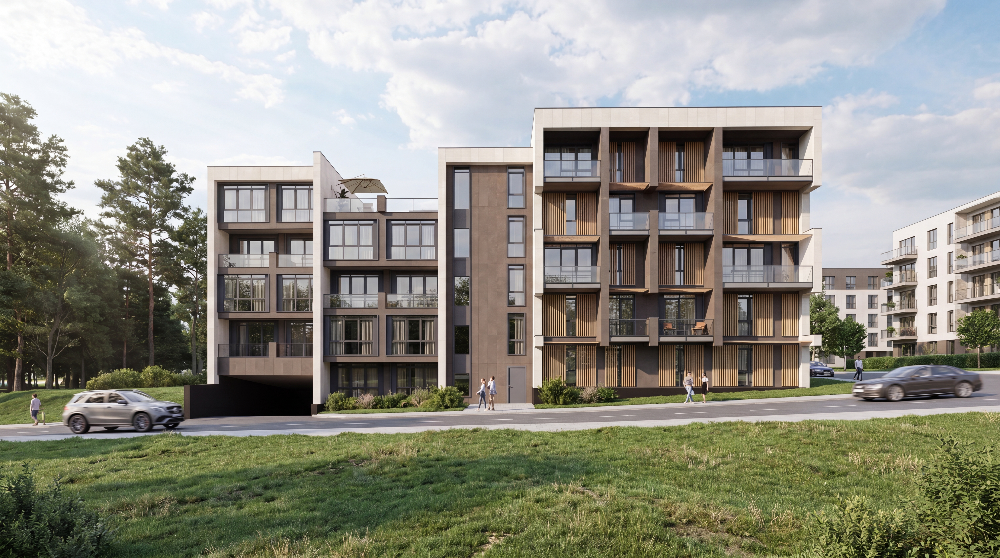](assets/gallery/urban-residential-front-view.jpg)

[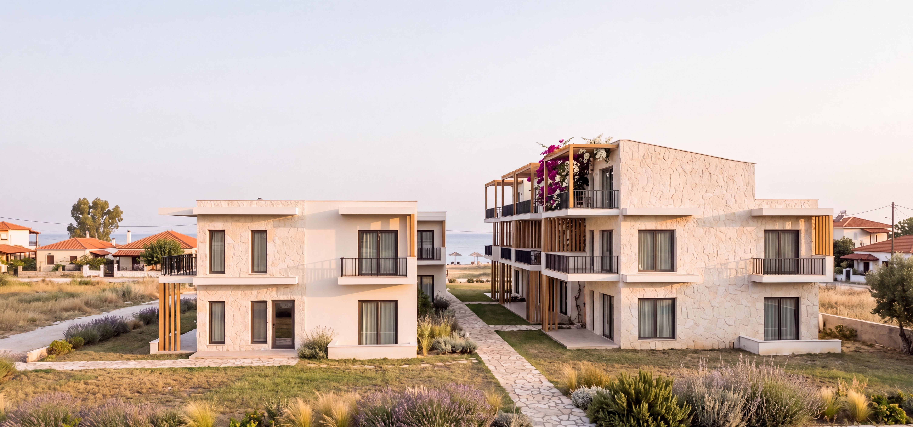](assets/gallery/mediterranean-residential-courtyard.jpg)

[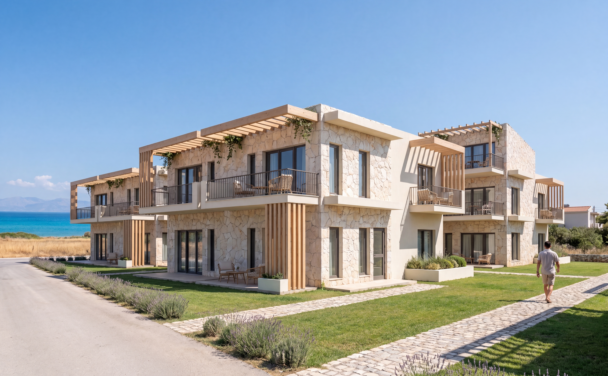](assets/gallery/mediterranean-residential-sea-view.jpg)

## Four separate testing levels

**1. Static package validation** — Python 3.13+ and the standard library only:

```shell
python tests/validate.py
```

Checks UTF-8, the flat string-only YAML metadata schema, all module paths, the six unique routing rows, positive/negative fixture consistency, local document links, output-contract markers, examples, the exact directory tree and required CI declarations. Natural-language rule consistency still needs review.

**2. Deterministic regression tests:**

```shell
python -m unittest discover -s tests -v
```

Mutation tests ensure missing modules, invalid encoding/metadata, duplicate routes, broken links and contradictory fixtures fail. Trace-scoring tests reject missing, extra or repeated module reads, wrong models, unnecessary selection questions and invalid output block structures. The 25 annotated scenarios include inherited context and model switches. These checks do **not** implement a second natural-language router or prove agent behavior.

**3. Optional real Codex agent tests** — requires an installed, authenticated Codex CLI. Existing account usage applies; ordinary CI needs no credentials:

```shell
python tests/agent_smoke.py run --case text-only --case explicit-nano --case geometry-correction --output ../agent-evidence
```

Each case launches a read-only real Codex session. An instrumented reader emits a marker only after a successful file read; the harness scores tool-output markers rather than the agent's claimed module list. JSONL events, final responses, observed reads and runtime token usage (when available) are stored outside the package. No image generation is authorized. The JSON response schema is a test transport, not the skill's normal output.

The follow-up fixture seeds the previous model and complete already-read instructions into the new session; it checks reuse of accessible context, **not** a resumed multi-turn conversation. The trace is controlled instrumentation, not an operating-system filesystem audit. Evidence is valid only for the tested CLI/runtime/cases. Prompt semantics and photographic validity need human review in addition to structural scoring.

In Windows development checks, real CLI sessions returned responses but execution policy blocked both the instrumented reader and a native read-only PowerShell probe before any module read could be traced. These attempts are **blocked behavioral tests**, not routing passes or evidence of router failure. The harness stops on that policy condition rather than weakening the policy or repeatedly consuming account usage. Static validation and all 15 deterministic regression tests passed at that stage.

**4. Image-generation quality tests** — [prepared benchmark protocol](tests/IMAGE_BENCHMARK.md), not automatically executed. Paid image access requires a separate explicit request and budget. Record model/interface versions and failures; do not treat text-only routing success as image-quality evidence.

## CI

Pushes and pull requests run static validation and deterministic regression tests on Python 3.13 using GitHub-hosted Linux runners. [The workflow](.github/workflows/validate.yml) uses the current `actions/checkout@v7` and `actions/setup-python@v7` major releases, with read-only contents permissions and no retained checkout credentials. Live Codex and image tests are excluded.

## Limitations and contributions

Image models cannot guarantee exact geometry, hidden dimensions, pixel preservation or correct technical text. Use accurate native views, supported masks/compositing and editable linework/text overlays when precision matters. New construction defaults to clean, maintained surfaces; realism does not automatically mean wear.

For changes, keep routing decisions in the router, add positive and negative fixtures, preserve both model formats, run the two ordinary checks and document behavioral limitations. Do not add a keyword-based production router, duplicate modules, third-party assets or model-service dependencies merely to make tests pass.

## Attribution and licensing

See [sources and licensing notes](SOURCES_AND_LICENSES.md). This published repository has **no explicit open-source license**; the licensing decision remains pending. Attribution does not grant rights to linked third-party content. No license was added in v1.0.
